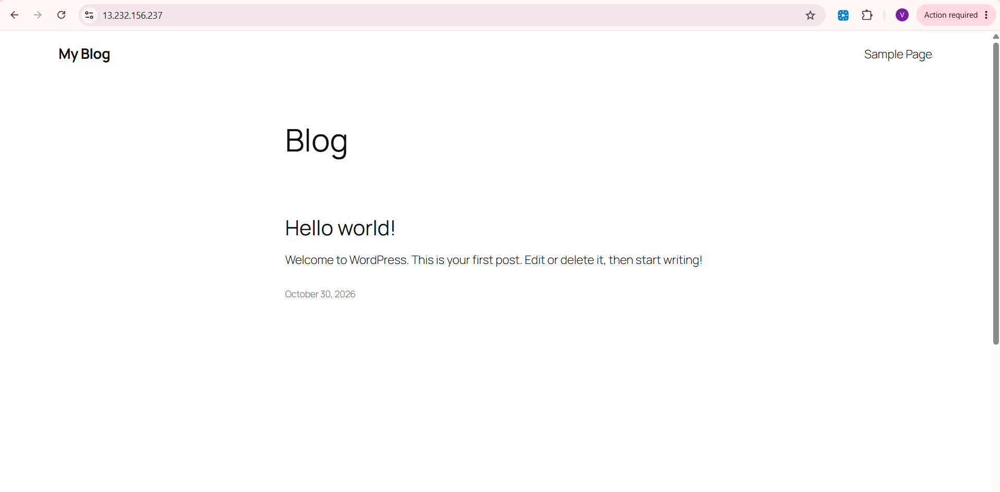
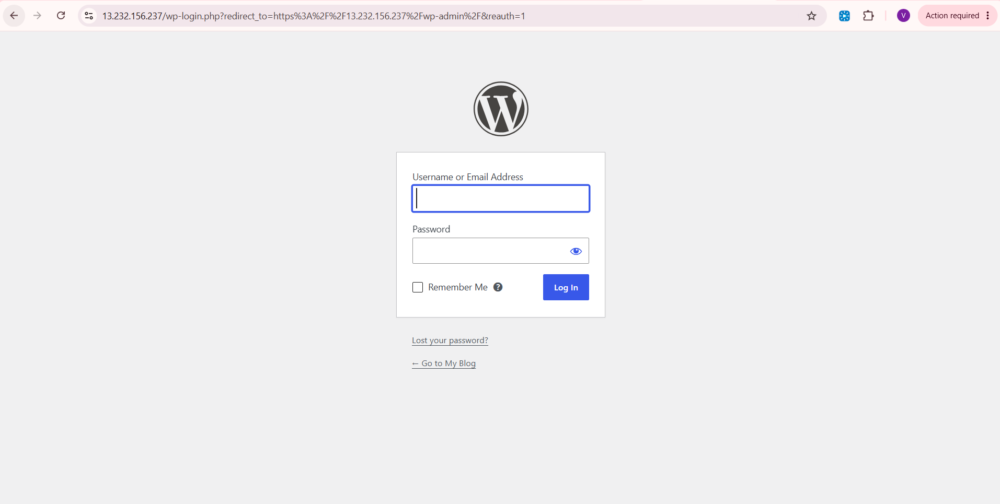
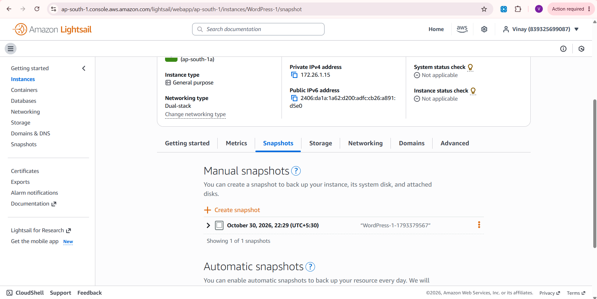

# WordPress Blog Deployment on AWS Lightsail

A step-by-step project that deploys a WordPress blog on **AWS Lightsail**, using a pre-configured Bitnami WordPress instance. It covers instance creation, accessing the site, retrieving admin credentials, and taking a backup snapshot.

---

## Table of Contents

- [Project Overview](#project-overview)
- [Tech Stack](#tech-stack)
- [Prerequisites](#prerequisites)
- [Deployment Steps](#deployment-steps)
- [Screenshots](#screenshots)
- [Optional Improvements](#optional-improvements)
- [Security Best Practices](#security-best-practices)
- [Key Learnings](#key-learnings)
- [Author](#author)

---

## Project Overview

AWS Lightsail provides pre-configured virtual private servers (VPS) at a predictable monthly price, which makes it a good starting point for hosting small applications such as a WordPress blog.

**Goal:** Deploy a working WordPress blog on AWS Lightsail and back it up with a snapshot.

---

## Tech Stack

| Component | Details |
|-----------|---------|
| Cloud Provider | AWS Lightsail |
| Application | WordPress (Bitnami stack) |
| Operating System | Linux (Debian-based Bitnami image) |
| Access | Browser and SSH (Lightsail browser-based terminal) |
| Backup | Lightsail Instance Snapshot |

---

## Prerequisites

- An active AWS account
- A web browser
- Basic knowledge of Linux commands

---

## Deployment Steps

### 1. Sign in to AWS and open Lightsail
- Open the **AWS Lightsail Console**.
- Click **Create instance**.

### 2. Choose an instance location
- Select the AWS Region closest to your target audience for better performance.

### 3. Select an instance image
- Choose **Apps + OS**, then select **WordPress**.
- Alternatively, choose **OS Only** if you want a fully custom setup.

### 4. Choose an instance plan
- Select a plan based on your expected traffic.
- The smallest plan is enough for a small blog.

### 5. Name and create the instance
- Give the instance a meaningful name, for example `my-wordpress-blog`.
- Click **Create instance** and wait for it to reach the **Running** state.

### 6. Access the WordPress site
- Open the instance and copy its **public IP address**.
- Paste it into your browser to see the WordPress welcome page.

### 7. Retrieve the WordPress admin credentials
- Click **Connect using SSH** in the Lightsail console.
- Run:

```bash
cat bitnami_application_password
```

- Use the password to log in at:

```
http://<your-public-ip>/wp-admin/
```

Default username: `user`

### 8. Back up the instance
- Go to the instance's **Snapshots** tab.
- Click **Create snapshot** and give it a name.
- Optionally, enable **automatic snapshots**.

---

## Screenshots

### 1. WordPress default welcome page
The site is live and reachable through the instance's public IP.



### 2. WordPress admin login page
The admin dashboard is reachable at `/wp-admin/`.



### 3. Instance snapshot
A backup snapshot of the instance was created from the Lightsail console.



---

## Optional Improvements

These steps are recommended for a production setup. They are **not** covered by the screenshots above.

### Attach a static IP
By default, the public IP can change after a stop/start. In the Lightsail **Networking** tab, create a static IP and attach it to the instance.

### Use a custom domain
Register a domain (for example through Amazon Route 53) and point its **A record** to the static IP.

### Enable HTTPS with Let's Encrypt
Run the Bitnami certificate tool over SSH and follow the prompts:

```bash
sudo /opt/bitnami/bncert-tool
```

### Optimize performance
Use a caching plugin such as **W3 Total Cache** or **LiteSpeed Cache**.

---

## Security Best Practices

- Keep WordPress core, themes, and plugins updated.
- Install a security plugin such as **Wordfence**.
- Change the default admin password after the first login.
- Restrict SSH access in the Lightsail firewall settings.
- Take regular snapshots (or enable automatic snapshots).
- Never commit passwords or keys to this repository.

---

## Key Learnings

- Launching a managed WordPress stack on a cloud VPS
- Connecting to a cloud instance over SSH and reading files on it
- Understanding public vs. static IP addresses
- Taking instance snapshots as a backup strategy
- Basic WordPress security and performance practices

---

## Author

**Vinay**
GitHub: [Vinay-PR-Gowda](https://github.com/Vinay-PR-Gowda)
